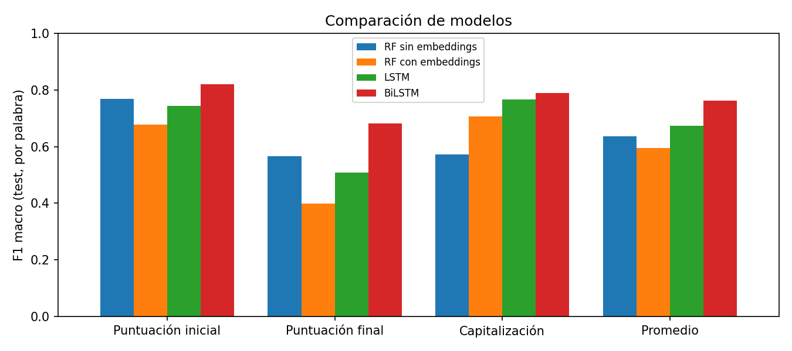
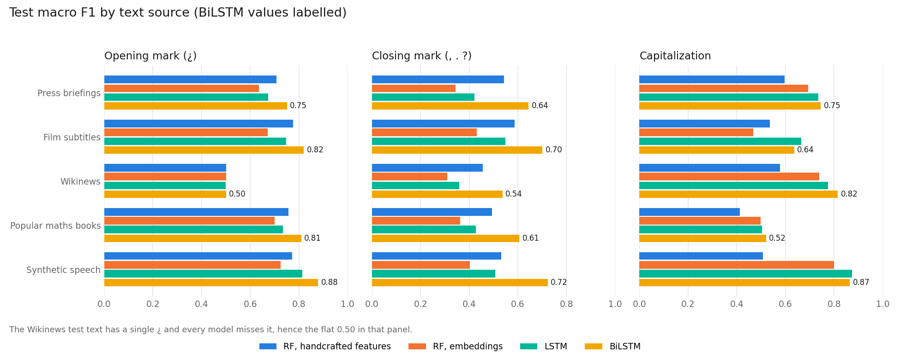
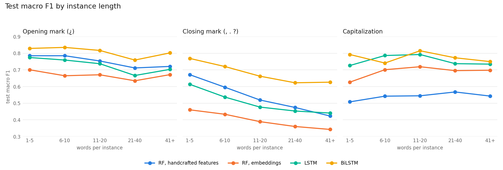

# Punctuation and capitalization restoration for Spanish

Speech transcripts often arrive as one long lowercase string. This project puts the punctuation and the capital letters
back, with a focus on Rioplatense Spanish. For every word it predicts three things:

| Task | Classes |
|---|---|
| Opening mark | none, `¿` |
| Closing mark | none, `,`, `.`, `?` |
| Capitalization | lowercase, Initial capital, miXed case, ALL CAPS |

Four models are compared under the same data, split and metric: two Random Forests (handcrafted features, word
embeddings), an LSTM and a bidirectional LSTM. Word vectors are the **static input embeddings** of
`bert-base-multilingual-cased` (the mean over a word's subword vectors). The BERT network itself is never run, so any
use of context has to come from the model on top.

I built this with three teammates for a Machine Learning course at the University of Buenos Aires (see
[Credits](#credits) for who did what).

## Results

Macro F1 per word on the test set (123,976 words). The last column is the mean of the three tasks with a 95 %
bootstrap interval that resamples whole documents.

| Model | Opening mark | Closing mark | Capitalization | Mean (95 % CI) |
|---|---|---|---|---|
| Always the majority class (reference) | 0.496 | 0.228 | 0.232 | 0.319 |
| Random Forest, static embeddings | 0.677 | 0.398 | 0.707 | 0.594 (0.582 to 0.603) |
| Random Forest, handcrafted features | 0.769 | 0.567 | 0.572 | 0.636 (0.619 to 0.650) |
| LSTM | 0.745 | 0.508 | 0.767 | 0.673 (0.655 to 0.685) |
| **Bidirectional LSTM** | **0.819** | **0.681** | **0.788** | **0.763 (0.751 to 0.773)** |

The BiLSTM beats the LSTM by 0.090 (95 % CI 0.082 to 0.103). For the networks the table shows the seed with the best
validation score; across three seeds the mean score is 0.761 for the BiLSTM and 0.670 for the LSTM.



### What we learned

- **Looking to the right matters most.** The largest gap between the two networks is on the closing mark (0.681 vs
  0.508): deciding whether a comma or a question mark follows a word is much easier when the next words are visible.
- **It is not only model size.** The selected BiLSTM is about six times larger (3.68 M vs 0.59 M parameters), but
  during the search a BiLSTM with 0.53 M parameters already scored 0.756 on validation against 0.669 for the
  0.59 M LSTM (one seed each, starting learning rates 3e-3 and 1e-3; the LSTM at 3e-3 scored 0.665).
- **Context beats embeddings for punctuation.** A Random Forest that sees simple features of a word and its two
  neighbours on each side outperforms one that sees a rich vector of the word alone on both punctuation tasks.
  Embeddings win clearly on capitalization (0.707 vs 0.572), which depends more on the identity of the word.
- **Rare classes are the hard part.** BiLSTM per-class F1 is 0.64 for `¿`, 0.51 for the comma, 0.68 for the period,
  0.58 for `?`, 0.63 for mixed case (only 190 test words) and 0.78 for all caps.
- **Long instances are harder** for the closing mark: all four models score much lower beyond 20 words than on
  instances of 1 to 5 words.





Confusion matrices and per-class charts are in [figures/](figures/), the underlying tables in
[results/final/](results/final/).

## Data

45,899 instances, 622,681 words, from five sources. An instance can be a piece of a sentence, one sentence, two, or
three to six.

| Source | Words | What it is |
|---|---|---|
| Press briefings | 243,286 | Question and answer turns from the Argentine presidential press office |
| Film subtitles | 187,268 | Spanish subtitles of 34 Argentine films ([list](docs/film_corpus.md)) |
| Wikinews | 87,840 | Spanish Wikinews sentences selected for acronyms and mixed-case names |
| Popular maths books | 75,226 | Two books by Adrián Paenza |
| Synthetic speech | 29,061 | Rioplatense-style utterances written with an LLM and reviewed by sampling |

**The data is not included.** Books and subtitles are copyrighted. [docs/data.md](docs/data.md) explains how each
file is built and what format training expects.

### Split

Train, validation and test (69.6 / 10.5 / 19.9 % of words) are split **by document**: a film, a briefing or a news
article never appears on two sides, and for the sources that are a single document the unit is the sentence. The split
is stratified so that rare classes are spread evenly. Its two random seeds were picked among 40 candidates by looking
only at label proportions, never at model performance. Details in [src/protocolo.py](src/protocolo.py).

## Method

| Model | Input | Search |
|---|---|---|
| Random Forest, handcrafted | Length, vowels, accents, position, keyword lists, for the word and 2 neighbours each side, plus one-hot of 150 frequent words | `class_weight`, `max_depth`, `min_samples_leaf`, per task |
| Random Forest, embeddings | 768-d word vector, no context | same grid |
| LSTM (H=128, 2 layers) | sequence of word vectors, three output heads | staged: size, regularization, class weights |
| BiLSTM (H=256 per direction, 2 layers) | same | same |

All of them may use per-class probability factors tuned on validation (kept only if they help on held-out validation
halves). The test set is measured once per final model.

## Repository layout

```
src/                      dataset builders, split and metrics, training, evaluation, inference
datasets/subtitulos/      scripts that find, download and check subtitles (no data)
notebooks/                end to end training notebook, embedding generation
notebooks/exploration/    earlier per-model notebooks, kept for reference
results/final/            tables, search logs and test predictions behind the numbers above
results/history/          earlier runs on a smaller dataset and an easier split (not comparable)
scripts/                  demo, figures, bootstrap intervals
tests/                    unit tests
docs/                     data notes and earlier reports (in Spanish)
```

Code comments, notebooks and file names are in Spanish.

## Reproducing

```bash
python -m venv .venv && source .venv/bin/activate      # Windows: .venv\Scripts\activate
pip install -r requirements.txt
pytest -q
python scripts/make_figures.py                         # works from the committed CSVs
```

With the dataset in `datasets/instancias_final/instancias_final.csv` (see [docs/data.md](docs/data.md)):

```bash
python src/embeddings_palabras.py --solo-embeddings    # writes salidas/*.npy and *.csv, CPU is enough
python src/busqueda_rf.py --modelo sin_emb
python src/busqueda_rf.py --modelo con_emb
python src/busqueda_lstm.py --modelo lstm --alphas     # a GPU helps
python src/busqueda_lstm.py --modelo bilstm --alphas
python src/evaluacion.py
python scripts/bootstrap_ci.py
```

**Use scikit-learn 1.6 or 1.7.** `StratifiedGroupKFold` assigns folds differently in 1.9, which silently changes the
test set. `requirements.txt` pins the range.

### What was re-checked

Checked while preparing this repository (Python 3.11.9, torch 2.0.1, transformers 4.44.2, scikit-learn 1.7.2):

| Check | Outcome |
|---|---|
| Rebuild embeddings and labels from the dataset | 622,681 words; data fingerprint `7bdb6554` and split `0b10b250` match the published runs (the split also with scikit-learn 1.6.1, not with 1.9.0) |
| `evaluacion.py` on the committed test predictions | the four tables in `results/final/` come out identical |
| `bootstrap_ci.py` | point estimates equal the table above |
| BiLSTM final configuration, retrained | one seed (0) on CPU for **14 epochs instead of 20**: best epoch 7, validation score 0.765, test F1 0.824 / 0.686 / 0.786 (mean 0.765). The published run with the same seed got 0.816 / 0.683 / 0.780 (mean 0.760) |

The retrained model lands close to the published one, but it is a single shorter run, so the results table above still
reports the original runs. The Random Forests, the LSTM, the hyperparameter searches and the download scripts were not
re-run.

## Demo

After training a network:

```bash
python scripts/demo.py "che vos sabés a qué hora sale el tren a mar del plata mañana"
```

With no arguments it runs a few sentences I wrote for it. This is the output of the 14-epoch checkpoint described
above:

```text
in : che vos sabés a qué hora sale el tren a mar del plata mañana
out: Che, ¿vos sabés a qué hora sale el tren a Mar del Plata, mañana?

in : no sé qué decirte la verdad me parece que mejor lo charlamos el lunes
out: No sé qué decirte, la verdad, me parece que mejor lo charlamos el lunes.

in : ayer fuimos con sofía al museo de bellas artes y después comimos una pizza en corrientes
out: Ayer, fuimos con Sofía al Museo de Bellas Artes y después comimos una pizza en Corrientes.

in : me podés pasar el informe antes de las cinco por favor
out: ¿Me podés pasar el informe antes de las cinco, por favor?

in : la onu y la unión europea anunciaron un nuevo acuerdo en ginebra
out: La ONU y la Unión Europea anunciaron un nuevo acuerdo en Ginebra,
```

Questions, names and acronyms come out well. Commas are the weak spot, as the metrics suggest: there is one too many
before *mañana*, the one after *Ayer* is unnecessary, and the last sentence ends in a comma instead of a period.

Trained weights are not distributed.

## Limitations

- The test set contains only 6 of the 34 films, so subtitle scores depend on which films landed there.
- Wikinews sentences were selected for rare capitalization, so that source does not reflect natural news text.
- The hyperparameter search used one seed per configuration; differences below about 0.015 are not meaningful.
- Mixed case (`iPhone`) is predicted as a class, but the exact casing cannot be rebuilt from it.
- `src/inferir.py` works from BERT subword tokens and starts a new word at every token without `##`. Training splits
  words on whitespace, so words with an apostrophe or hyphen are handled differently at inference.
- The test is word-level macro F1 on written sources. Nothing here was evaluated on real speech recognizer output.

## Credits

This is our group work. These are the main contributions according to the commit history:

| Who | Contributions |
|---|---|
| Kenneth ([kennobith](https://github.com/kennobith)) | Instance and embedding pipeline, first Random Forest baseline, press briefing scraper, Wikinews source, LSTM, hyperparameter search, document-level split, final training runs, evaluation and inference |
| Me ([TadeoKaufmann](https://github.com/TadeoKaufmann)) | My part: the subtitle download and cleaning pipeline, the repository structure, the synthetic dataset, the first version of the four-class instance builder and the first bidirectional LSTM implementation |
| Mauricio Enrich ([MauricioEnrich](https://github.com/MauricioEnrich)) | Random Forest tuning and decision thresholds ([notebook](notebooks/exploration/random_forest_pipeline_completo.ipynb), [report](docs/history_random_forest.es.md)) |
| Santi Maciel ([SantiMaciel](https://github.com/SantiMaciel)) | Handcrafted features for the Random Forest without embeddings, later moved to [src/atributos_rf.py](src/atributos_rf.py) |

I added the demo, the tests, the bootstrap intervals, the extra figures and this English documentation afterwards.
